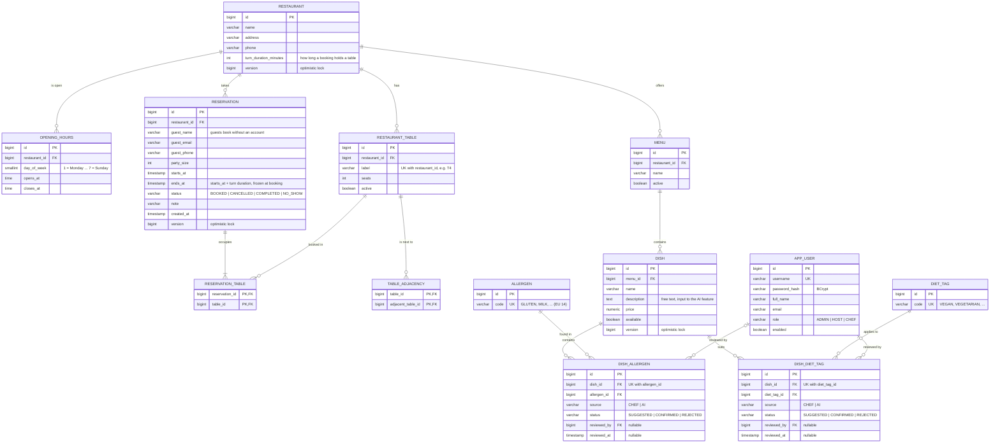

# Domain model — P05 Restaurant reservation and menu

The rendered diagram is in [`domain-model.png`](domain-model.png). The Mermaid source below is the master copy:
GitHub renders it directly, and the PNG is regenerated from it.

## Entity diagram

## Aggregates

| Aggregate | Root → children | Full CRUD on screens + REST |
|---|---|---|
| Restaurant (main) | Restaurant → RestaurantTable, OpeningHours, Reservation | yes |
| Menu | Menu → Dish → DishAllergen / DishDietTag | screens needed for the chef and the AI review |

The spec names the chain *Restaurant → RestaurantTable → Reservation*. A reservation is attached to the
restaurant and *occupies* one or more tables through `RESERVATION_TABLE`. A single-table booking has one row
there, and a combined booking (advanced requirement 3) has several. The reasoning is in
[ADR-0001](adr/0001-persistence-model-reservations-and-tables.md).

## Entity notes

- **AppUser** – staff accounts only. Guests never log in. The menu, the allergen and diet filter, the
  availability search and the booking form are public, and a booking stores the guest's contact details.
  There are three staff roles with genuinely different capabilities:
  - `ADMIN` manages restaurants, tables, adjacency, opening hours and users.
  - `HOST` manages all reservations: view, edit, cancel, mark no-show.
  - `CHEF` manages menus and dishes and is the only role that confirms or rejects allergen and diet suggestions.

  Accepted limitation: a guest cannot cancel online, only by contacting the restaurant.
- **Restaurant.turnDurationMinutes** – configurable per restaurant (advanced requirement 1).
- **OpeningHours** – a separate entity rather than an embedded value. A day may have several rows, such as
  lunch and dinner, and the availability query joins it. Limitation: a slot cannot cross midnight.
- **TableAdjacency** – a plain self many-to-many on `RestaurantTable`. Both directions are stored (A→B and B→A)
  so that "neighbours of T" is a single indexed lookup. The service layer keeps the pairs symmetric.
- **Reservation**
  - `endsAt` is stored rather than computed. If the turn duration changes later, existing bookings stay
    where they are. The overlap check becomes the index-friendly `starts_at < :end AND ends_at > :start`.
  - `@Version` handles concurrent edits of the same reservation.
  - Two people booking the *same table* at the same moment is handled by a pessimistic lock on the chosen
    table rows inside the booking transaction (ADR-0001).
- **Times** – `LocalDateTime` in the restaurant's local time (one application-wide zone, Europe/Zagreb), stored
  as `timestamp without time zone`.
- **Allergen / DietTag** – reference data seeded by Flyway. Only the `code` is stored. Display names come from
  `messages_hr.properties` / `messages_en.properties`, so i18n needs no extra tables.
- **DishAllergen / DishDietTag** – association entities *with attributes*. `status` is the safety rule from the
  topic:
  - The AI writes rows as `SUGGESTED`.
  - Only a `CHEF` turns them into `CONFIRMED` or `REJECTED`.
  - Guest-facing queries read `CONFIRMED` rows only.
  - `REJECTED` rows are kept so the AI does not propose the same thing again, and they feed
    `docs/ai-evaluation.md`.

## Coverage of the LO4 requirements

| Requirement | Where |
|---|---|
| One-to-many | Restaurant → RestaurantTable, Restaurant → Reservation, Menu → Dish, … |
| Many-to-many with an association entity carrying attributes | Dish ↔ Allergen via `DishAllergen` (source, status, reviewer, time) |
| Optional relation | `DishAllergen.reviewedBy` / `DishDietTag.reviewedBy` (empty until a chef reviews an AI suggestion) |
| Plain many-to-many | Reservation ↔ RestaurantTable, RestaurantTable ↔ RestaurantTable (adjacency) |
| N+1 candidate to find, fix and document | Menu page: dishes → confirmed allergens (fix with a fetch join or entity graph) |
| Lazy vs eager | Everything `LAZY` by default. Joins are explicit per use case, and `spring.jpa.open-in-view=false`. |

## How the advanced requirements use the model

1. **Availability search.** For a restaurant, date and party size:
   - Generate candidate start times from `OPENING_HOURS` so that a slot plus the turn duration still ends
     before closing.
   - A table is free when no `BOOKED` reservation in `RESERVATION_TABLE` overlaps the slot.
   - Planned index: `reservation (restaurant_id, starts_at)` plus the primary key of `reservation_table`
     (`table_id` first). This is the "hard part" and the target of the performance measurement.
2. **Allergen and diet filter.** One query with a `NOT EXISTS` subquery for "contains none of these allergens"
   and a grouped `EXISTS … HAVING COUNT = n` for "has all of these diet tags". Both look only at `CONFIRMED`
   rows. Built with JPA Criteria / Spring Data `Specification` so any combination of criteria stays one query.
3. **Combining adjacent tables.** When no single free table seats the party, search connected groups of free
   tables in the `TABLE_ADJACENCY` graph (breadth-first, smallest group first) whose seats add up to the party
   size. The result is one reservation with several `RESERVATION_TABLE` rows.

## Open questions for the topic acceptance meeting

- Which aggregate must have full CRUD over REST: Restaurant → Table → Reservation only, or Menu → Dish as well?
- P05 does not describe a domain scheduled job (LO7). Proposed: a nightly job that marks past `BOOKED`
  reservations as `COMPLETED`, with no-shows set by staff. The second job is a reminder for reservations
  tomorrow, which writes a log line or notification.
